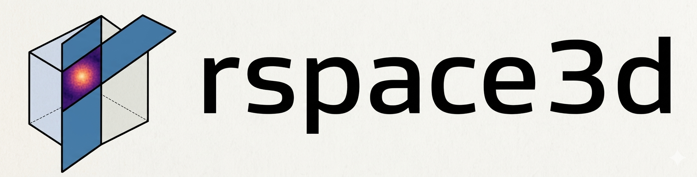
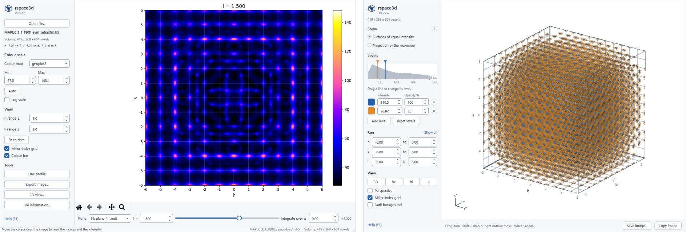
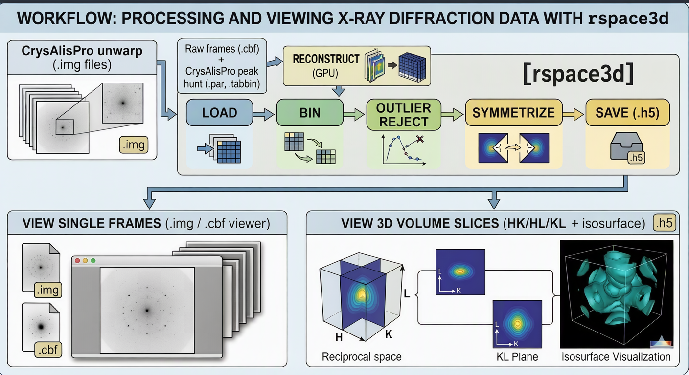
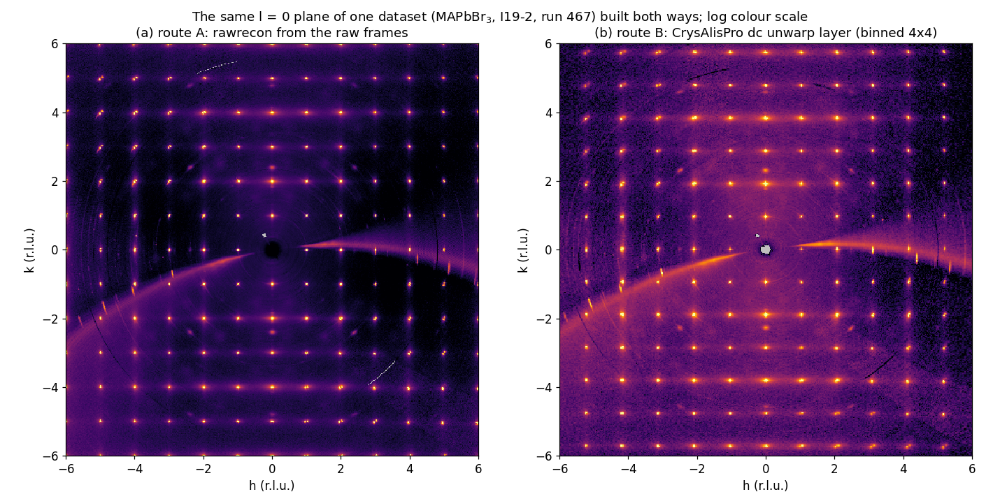
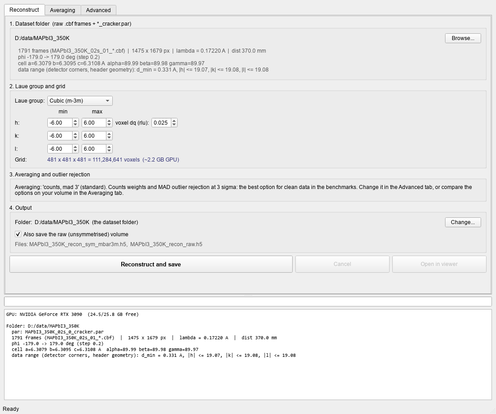
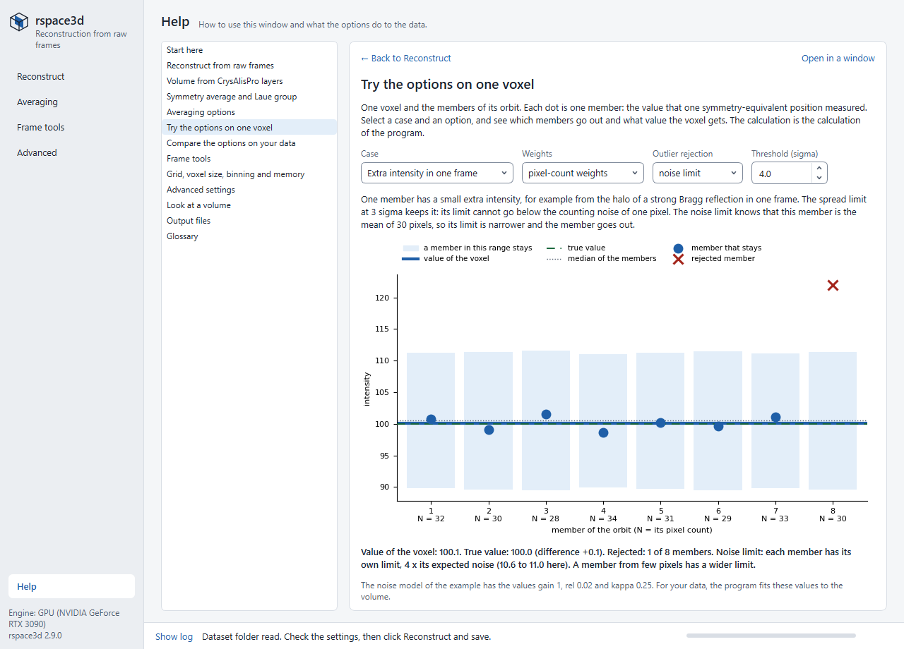
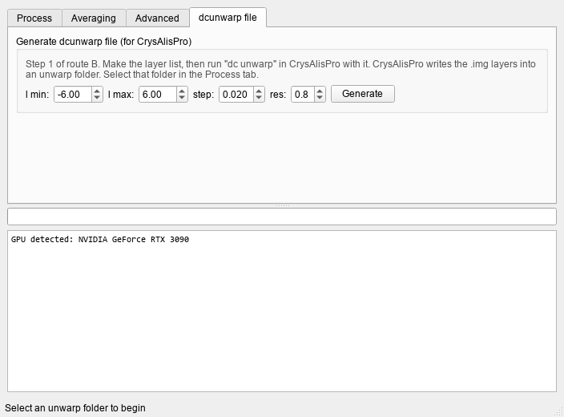
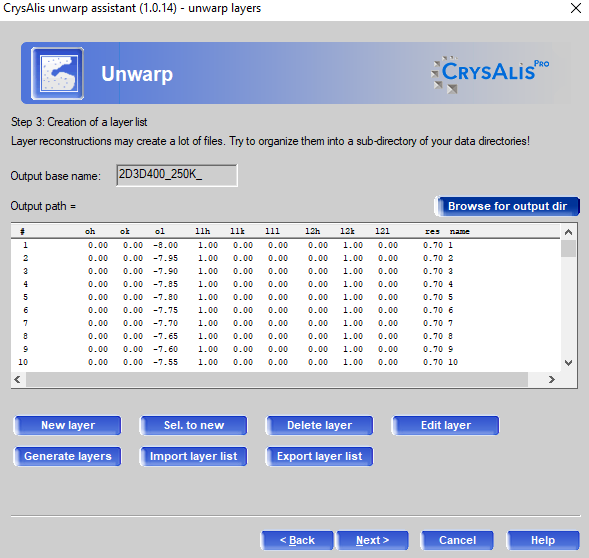
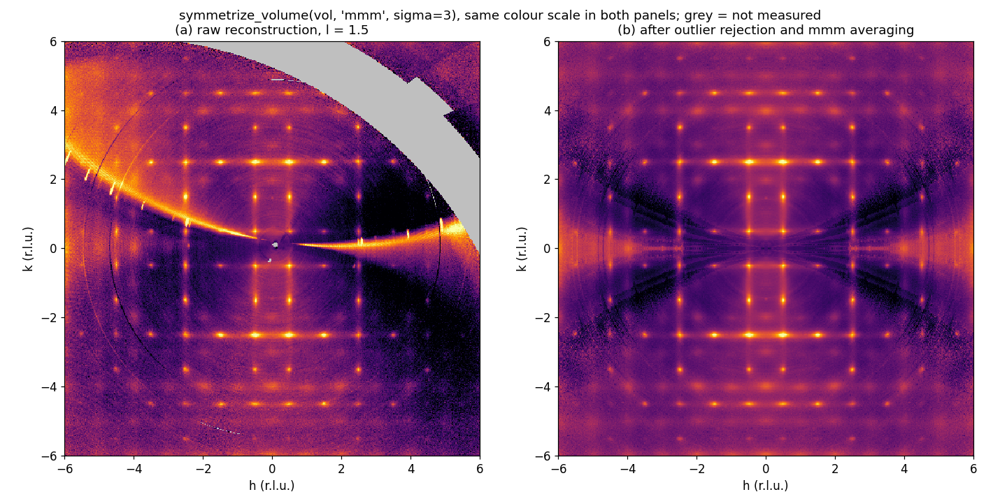
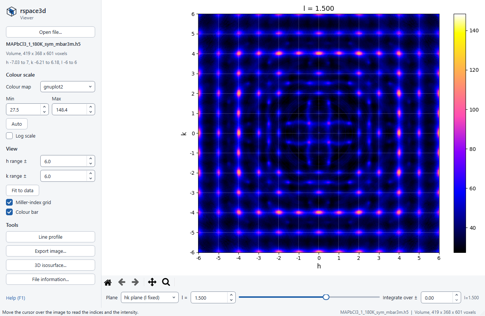

# rspace3d



Reciprocal-space 3D processing for single-crystal X-ray diffuse scattering
measured as a rotation scan on a flat area detector and processed in
[CrysAlisPro](https://rigaku.com/products/crystallography/x-ray-diffraction/crysalispro).

rspace3d turns a CrysAlisPro experiment into a 3D volume on a regular
(h, k, l) grid, cleans it with symmetry averaging and outlier rejection, and
lets you inspect it. It builds the volume directly from the raw detector
frames: the UB matrix comes from CrysAlisPro's `_cracker.par`, the detector
geometry, the rotation axis and the crystal orientation are fitted to
CrysAlisPro's peak-hunt table (`_peakhunt.tabbin`), and every pixel of every
frame is then mapped to (h, k, l) and accumulated on the GPU. A full scan is
reconstructed in about half a minute, whereas assembling the same volume from
CrysAlisPro's `dc unwarp` layers takes hours. Volumes built from `dc unwarp`
layers are supported as well.



## Contents

- [Two routes to a volume](#two-routes-to-a-volume)
- [Speed](#speed)
- [Installation](#installation)
- [Route A: reconstruction from the raw frames](#route-a-reconstruction-from-the-raw-frames)
- [Route B: volume from CrysAlisPro unwarp layers](#route-b-volume-from-crysalispro-unwarp-layers)
- [Symmetrisation and outlier rejection](#symmetrisation-and-outlier-rejection)
- [Viewing volumes](#viewing-volumes)
- [Python API summary](#python-api-summary)
- [HDF5 output format](#hdf5-output-format)
- [Laue groups](#laue-groups)
- [How the hkl grid is computed for .img layers](#how-the-hkl-grid-is-computed-for-img-layers)
- [Citing](#citing) and [License](#license)

## Two routes to a volume



- **Route A, reconstruction from the raw frames** (`rspace3d.rawrecon`; GUI
  `rspace3d-reconstruct`). Inputs are the raw `.cbf` frames, the
  `<exp>_cracker.par` and the `<exp>_peakhunt.tabbin` of the experiment. No
  `dc unwarp` step is needed.
- **Route B, assembly of CrysAlisPro `dc unwarp` layers** (`.img` files; GUI
  `rspace3d-builder`, command line `rspace3d-process`).

Both routes write the same HDF5 format and share the binning, symmetrisation,
viewer and Python API. The reverse operation, projecting a volume back onto an
area detector at any diffractometer setting, is done by
[xrays-on-detector](https://github.com/dubajicmilos/xrays-on-detector).



*The l = 0 plane of one dataset (MAPbBr₃, I19-2) built by both
routes: (a) from the raw frames with rawrecon, (b) CrysAlisPro's `dc unwarp`
layer, binned 4 × 4 to a similar voxel size. Both show the same Bragg peaks,
diffuse streaks and arcs. Each panel has its own log colour scale, because the
two volumes are on different intensity scales.*

## Speed

Measured on one NVIDIA RTX 3090 for the dataset in the figure above: 1735 frames of
2068 × 2162 pixels, reconstructed onto a 480 × 480 × 480 grid (h, k and l from
-6 to 6 at 0.025 r.l.u.).

| Step | Time |
|---|---|
| Geometry fit from the peak-hunt table | about 4 s |
| Accumulation of all 1735 frames on the GPU | 34 s (about 20 ms per frame) |
| The same accumulation on the CPU | about 1 s per frame, about 30 min in total |
| Outlier rejection and mmm averaging of the 480³ volume on the GPU | about 3 s |
| The same volume through CrysAlisPro `dc unwarp` (601 layers, route B) | hours |

## Installation

Requirements: Python 3.10 or newer.

```bash
git clone https://github.com/dubajicmilos/rspace3d.git
cd rspace3d
pip install -e .
```

This installs the dependencies (numpy, scipy, fabio, h5py, matplotlib, PyQt6)
and these commands:

| Command | What it does |
|---|---|
| `rspace3d-reconstruct` | route A: GUI for reconstruction from the raw frames |
| `rspace3d-builder` | route B: GUI that builds a volume from `dc unwarp` layers |
| `rspace3d-process` | route B from the command line |
| `rspace3d-viewer` | viewer for `.h5` volumes, `.img` layers and `.cbf` frames |
| `python -m rspace3d.make_dcunwarp` | writes CrysAlisPro `.dcunwarp` layer lists for route B |

Each command can also be run as `python -m rspace3d.<module>`.

GPU acceleration, strongly recommended for route A, needs an NVIDIA GPU and
CuPy:

```bash
pip install cupy-cuda12x      # CUDA 12 driver; use cupy-cuda11x for CUDA 11
```

CuPy is detected automatically; without it everything runs on the CPU. Optional
3D isosurface backends: `pip install pyvista` or `pip install plotly`.

Without a GPU, install numba with the extra `cpu`:

```bash
pip install -e ".[cpu]"       # or: pip install numba
```

rspace3d then does the symmetrisation on all CPU cores, about 20 to 30 times
faster than without numba. numba is optional. Without it, a NumPy engine
gives the same result. The extra `all` installs CuPy, numba, PyVista and
Plotly.

### Updating

```bash
pip install --upgrade git+https://github.com/dubajicmilos/rspace3d.git
```

This pulls the latest `main` and replaces the installed version. If you
installed from a local clone with `pip install -e .`, run `git pull` inside
the clone instead; the changes take effect immediately.

### Try it on the example volume

`example_data/example_monoclinic.h5` is a small processed volume of a
monoclinic 2D halide perovskite measured at I19, Diamond Light Source, at 250 K
(binned 4 × 4):

```bash
python -c "import rspace3d, rspace3d.rawrecon; print(rspace3d.__version__)"
rspace3d-viewer example_data/example_monoclinic.h5
```

In the viewer, switch between the hk, hl and kl planes, step through slices,
tick *Miller-index grid* for the overlay, and try the line-profile tool and
*3D isosurface...*.

## Route A: reconstruction from the raw frames

The geometry fit, the peak-hunt file format and the intensity corrections are
described in [`rspace3d/rawrecon/README.md`](rspace3d/rawrecon/README.md).

### What you need

One folder, normally the CrysAlisPro experiment folder, containing:

| File | Purpose | Required |
|------|---------|----------|
| `<stem>_0001.cbf`, `<stem>_0002.cbf`, ... | the raw rotation frames (Dectris miniCBF as written by Eiger and Pilatus detectors). Intensities, wavelength, pixel size, header distance and beam centre, and the goniometer `Phi` / `Angle_increment` are read from them. | yes |
| `<exp>_cracker.par` | the refined UB matrix (unit cell and orientation) and the wavelength | yes |
| `<exp>_peakhunt.tabbin` | CrysAlisPro's peak-hunt table: indexed reflections with pixel position, frame number and reciprocal vector. The geometry fit uses it as ground truth. | yes (recommended path) |

CrysAlisPro writes the `.par` and `.tabbin` files into the experiment folder
when you run **peak hunting** and then **find and refine the unit cell**
(Lattice wizard). Run the unit-cell step after the peak hunt, so that the peak
table is indexed with the same UB matrix that ends up in the `_cracker.par`.
Use the `_cracker.par`, not the plain `<exp>_0.par`: the plain file may hold an
automatically reduced cell that does not index the frames.

Notes on file discovery:

- Frames are found by file name, not by folder name. Files named
  `<prefix><number>.cbf` are grouped by prefix and the largest group is used
  (sub-folders such as `bup/` or `tmp/` are ignored).
- If the `.par` sits in a sub-folder, tick *Search subfolders for the .par file*
  on the Advanced page of the GUI or pass `par_path=` in the API.
- The CBF headers must carry `Angle_increment` and `Phi` (standard in miniCBF).
  The scan may be a phi or an omega scan: the rotation axis and its sense are
  fitted from the peak table, and the header angle is used only as a datum.

### Using the GUI

```bash
rspace3d-reconstruct          # or: python -m rspace3d.reconstruct_gui
```

The window has a side bar with five pages: *Reconstruct*, *Averaging*, *Frame tools*,
*Advanced* and *Help*. For clean data you need only the first one. The progress
bar, a status line and the log are below the pages (*Hide log* closes the log).
A small **?** button opens the help for one part of a page, and **F1** opens
the help for the page that you see.



**Reconstruct page** (five numbered steps and one button):

1. **Dataset.** Click *Browse...* and select the folder. The window shows the
   number of frames, the detector size and distance, the wavelength, the phi
   range and the unit cell read from the `.par`. If it reports that no `.par`
   was found, tick *Search subfolders for the .par file* on the Advanced page.

2. **Grid.** Set the `h`, `k` and `l` minimum and maximum in reciprocal-lattice
   units (they need not be symmetric or equal) and the voxel size (default
   0.025 r.l.u.). The column *data reach* shows the largest |h|, |k| and |l| at
   the detector corners (from the frame header). The line *Grid size* shows the
   voxel count and the GPU memory needed during accumulation (20 bytes per
   voxel: float64 sum, int32 pixel count and float64 sum of squares for the
   variance). It changes to the error colour when this approaches the free
   VRAM. A 481 × 481 × 481 grid (-6 to 6 at 0.025) needs about 2.2 GB.

3. **Symmetry.** Select the Laue group of the phase. An experiment that lowers
   the symmetry (for example an applied field) needs a lower group. The window
   checks only that the cell metric allows the group (the test of
   `laue_metric_residual`, limit 0.02). If the metric does not allow the group,
   the window shows a note. When you load a folder, it then selects the group
   of highest order that the cell allows. The metric cannot tell a cubic cell
   from a cell with a small distortion, so the choice of the group stays yours.

4. **Averaging and outlier rejection.** The line shows the option that the
   symmetrise step uses. The standard for raw frames is
   `'pixel-count weights, noise limit (4 sigma)'`: each orbit member has the
   weight of its pixel count. The app fits a noise model to the volume, and a
   member farther than 4 × its expected noise from the orbit median is
   rejected. This rule removes intensity that is in one frame only (for
   example the halo of a strong Bragg reflection). The spread limit does not
   remove it, because its lowest limit is the Poisson value of one count and
   a voxel is the mean of many pixels. In tests on four raw-frame datasets
   (I15 and I19-2) the noise limit gave a split-half difference in the
   diffuse region that is 0.5 to 3.9 % lower than the spread limit, and 10 to
   18 % higher near the Bragg nodes on the I15 datasets. If the noise-model
   fit fails, the app uses `'pixel-count weights, spread limit (3 sigma)'`
   and writes this in the log. The number is the threshold; set a different
   value on the Advanced page (*Custom*). For data with powder
   rings or other contamination, use the Averaging page (see
   [The Averaging panel](#the-averaging-panel-and-the-command-line-flags)).

5. **Output.** The output folder (default: the dataset folder) and the file
   names: `<folder name>_recon_sym_<laue>.h5` (for example
   `_recon_sym_mbar3m.h5` for `m-3m`) and, if *Also save the raw
   (unsymmetrised) volume* is ticked (default), `<folder name>_recon_raw.h5`.
   In the raw volume, unmeasured voxels are `NaN` and measured voxels with zero
   counts are `0.0`. With the raw volume you can symmetrise again later
   without a new reconstruction. The window asks before it overwrites a file.

**Reconstruct and save** (the button below the steps, or Ctrl+Return)
reconstructs, symmetrises (with the bin factors of the Advanced page) and
saves. The line next to the button says what a click does, or why the button
is off. The log shows the geometry fit (which pixel convention was chosen, how
many peaks indexed cleanly, the fit residual in Å⁻¹, the self-check in r.l.u.),
the unit cell, the progress per frame, the run time, the fraction of voxels
that received at least one pixel and whether the symmetry operations were
exact maps. If only the Laue group, the averaging or the output changed, the
next click uses the reconstruction in memory and does not reconstruct again. A
change of the grid, the frames, the bin factors or the pixel options starts a
new reconstruction. *Cancel* stops a reconstruction after the current frame;
the window keeps the earlier reconstruction. *Open in viewer* opens the last
saved symmetrised volume.

**Advanced page** (the defaults are the standard settings; *Reset to the
standard settings* sets them again):

- *Frames to use* (0 = all): use fewer frames for a quick test.
- *Search subfolders for the .par file*.
- *Geometry from the CrysAlisPro peak table*: leave this ticked. It fits the
  full geometry from the peak table. Unticking it falls back to indexing
  frame 1 with the header geometry, which works only for clean datasets with a
  correct header and a vertical rotation axis.
- *Use the GPU (CuPy)*: untick to force the CPU path.
- *Solid-angle and polarisation corrections* (on by default), with the
  polarisation fraction (0.95 for a synchrotron, 0.5 for an unpolarised
  source). The Lorentz factor is applied implicitly by the per-voxel
  normalisation.
- *Hot-pixel limit*: pixels with counts above this value are ignored. The
  default (0 = off) keeps every pixel. A value such as 1e6 removes zingers
  but also clips saturated Bragg maxima on detectors that count above it
  (the Eiger at I19-2 reaches about 1.3e6 in Bragg cores).
- *Bin factor h, k* and *Bin factor l*: the bin factors for the symmetrised
  volume. The voxel centres are multiples of `dq` × bin, so hkl = 0 is a voxel
  centre after the binning. Then the operations of all 11 Laue groups,
  trigonal and hexagonal included, are exact index maps. The grid can extend
  past the minimum and maximum by up to half a binned voxel. The raw volume is
  not binned.
- *Averaging and outlier rejection*: *Standard* or *Custom* (weights
  `equal`, `counts` or `adaptive`, rejection `mad`, `model` or `none`, and
  sigma). For `adaptive` or `model`, the symmetrise step first fits the noise
  model to the volume (about 30 s more with a GPU on a large volume).

**Averaging page**: measure and compare the averaging options on the volume in
memory (three numbered steps on the left, the results on the right). Its
*Symmetrise and save* button saves with the applied option, so you do not have to
go back to the first page. **Frame tools page**: see below.

**Help page**: how to use the window, what the symmetry average and each
averaging option do to the data, how to read the tables of the Averaging page,
and a glossary. The topic *Try the options on one voxel* is an interactive
example: it shows the members of one orbit and which of them an option
rejects. It uses the estimator of the program.



### Using the Python API

```python
from rspace3d import rawrecon
from rspace3d.volume_builder import bin_volume, symmetrize_volume, save_volume_h5

folder = "path/to/experiment"      # .cbf frames + <exp>_cracker.par + <exp>_peakhunt.tabbin

# Geometry from the peak table + reconstruction (GPU if CuPy is available).
vol, info = rawrecon.reconstruct_dataset(
    folder,
    ranges=((-6, 6), (-6, 6), (-6, 6)),   # h, k, l ranges in rlu
    step=0.025,                           # voxel size in rlu
    corrections=True,                     # solid angle + polarisation (E perpendicular to osc axis)
    hot=None,                             # ignore counts above this; None = keep all
    use_tabbin=True,                      # fit geometry from the tabbin (default is False)
    log=print)                            # progress lines

print(info["index_rms"], info["geom_hkl_dev"], info["measured_voxels"])
print("Bragg registration RMS (rlu):", rawrecon.bragg_registration_rms(vol))

# vol.data is (nh, nk, nl) float32 with NaN where unmeasured; vol.H/K/L are the axes.
vd = rawrecon.reconstruct_to_volumedata(vol, source_folder=folder)
save_volume_h5("sample_recon_raw.h5", vd)

vd2 = bin_volume(vd, 2, 2, 2)                       # optional
sym = symmetrize_volume(vd2, "m-3m", sigma=3.0)     # sigma=None: no outlier rejection
save_volume_h5("sample_recon_sym_mbar3m.h5", sym)
```

Other entry points: `rawrecon.geometry_from_tabbin(folder)` returns the fitted
`FittedGeometry` (detector, UB, R0, oscillation axis, sense, residuals);
`rawrecon.reconstruct_volume_gpu` and `rawrecon.reconstruct_volume` are the
accumulation engines if you want to supply your own geometry; and
`rawrecon.read_tabbin(path)` parses a peak-hunt table. The API table in
`rspace3d/rawrecon/README.md` lists everything.

Assumptions: flat detector at 2θ = 0, single-axis rotation scan,
monochromatic beam. Multi-axis scans and curved detectors are not supported.

### Checking the result

In the log:

- *best fit rms* is the residual of the geometry fit over the peak table, in
  Å⁻¹. Values around 0.001 to 0.002 Å⁻¹ are typical of a good fit.
- *validation: fitted peaks -> integer hkl, median dev* should be a few
  hundredths of an r.l.u. The same line gives the value for the held-out peaks
  (the peaks that the fit did not use). If one of the two values is above
  0.1 r.l.u., the run is aborted.
- *Bragg registration RMS* is the distance of the 300 brightest well-measured
  voxels from the nearest integer node. A value below the voxel size (0.025)
  means that the volume is registered to the lattice. Strong powder rings from
  the sample environment (bright, non-integer positions) can inflate this
  number, so check by eye as well.
- *measured ... voxels (xx%)* is the fraction of the grid covered by the scan.

Then open the volume in the viewer, switch on the Miller-index grid and step
through a few `l` planes: Bragg peaks must sit on the grid intersections in all
three plane orientations. Smeared or doubled peaks mean that the geometry is
wrong (see the troubleshooting table).

### Frame tools (contamination that changes between frames)

Some contamination is in the beam for part of the scan only: powder rings of
a wire or a sample holder, an additive background, or a shadow. A symmetry
average does not remove it fully, because each voxel gets it from different
frames. The frame tools of `rawrecon` (new in 2.6.0) use the frames again:

- `reconstruct_dataset(..., halves=True)` makes the odd-frame and even-frame
  volumes in the same pass (`vol.parts`). Their difference is a noise estimate.
  The frames must have odd and even numbers. The host needs about 120 bytes
  per voxel at the peak of this pass, against about 55 bytes per voxel
  without halves.
- `ring_statistics` and `detect_rings` find powder rings from the frames.
  `RingMask` removes the ring bands from the frames of the ring event. You can
  also give the bands yourself (`RingMask.from_bands`). The detector needs
  frames without the rings before or after the ring event in the frames that
  you give. If all frames have the rings, it finds no ring. The ring mask
  depends on the frames that you give. Check the number of ring frames when
  you change the frame range.
- `frame_map` shows the agreement of each frame and detector sector with a
  first average, and the radial residual profile. The map value is the
  observed / predicted ratio of a frame and sector, divided by the median of
  this ratio over all frames of the same sector. Thus 1 means agreement with
  the other frames. `FrameMap.summary()` counts the frames whose median over
  the sectors differs from 1 by more than 10 %. A frame without counts gets
  the lowest value and counts as off. On the real data the ratio before this
  normalisation is not 1. For the full frame map of one I19-2 scan
  (MAPbBr3) its median was 0.94. Real changes between frames and sectors
  lower the ratio. They were the main cause in this scan. The cause of these
  changes is not known. The orbit median is lower than the orbit mean. This
  raises the ratio.
- `run_frame_chain(info['setup'], laue)` runs the frame chain: ring mask, a
  model of additive and scale contamination for each frame (3 iterations),
  then the plain orbit mean. Get `info['setup']` with
  `reconstruct_dataset(..., keep_setup=True)`, or call `prepare_setup`. The
  output file records the options and the fit summary (attribute
  `frame_tools`).

Limits of the frame tools:

- The frame chain was validated with Laue group mmm and 0.2-degree frames
  (I19-2 and I15 data). Other Laue groups and frame widths work, but they
  are not validated.
- A test on synthetic data gave a smaller error for 2/m, 4/mmm and m-3m. For
  Laue group -1 the same test showed no gain from the chain.
- For another frame width the method scales its frame windows with
  0.2 / width.
- `info['setup']` (only with `keep_setup=True`) is not a JSON value. Remove
  it before you serialise `info`.
- Host memory of `run_frame_chain`: 6.0 GB above the memory before the call
  at the peak (measured: GPU, 1735 frames, 1785 radial bins, grid
  297 x 297 x 241, no halves). The peak is in the table fit. The table part
  grows with the number of frames and of radial bins.

In `rspace3d-reconstruct`, the *Frame tools* page has these steps as buttons,
each with a line that says what it does. Reconstruct a volume first. *Ring mask* and *Frame
model* make corrected volumes. Select a volume in the list *Volume in use*, then
click Measure and Compare on the Averaging page. *Split-half check* adds the split-half difference
of each candidate to the Results table. *Frame map* shows the frame map of the
selected volume. The frames of this pass are not corrected with the frame
model. The colour scale of the map is logarithmic: white is 1, red is more
counts and blue is fewer counts than in the other frames. The scale stops at
1/1.5 and 1.5. If *Ring mask* finds no ring, the volume is the same as the
uncorrected volume, and *Frame model* applies the frame model only. The file
name tag then follows the metadata (`_framemodel`, not
`_ringmask_framemodel`). A change of the Laue group removes the 'ring mask + frame model'
volume and the frame map. *Reconstruct and save* (Reconstruct page) and *Symmetrise and save*
(Averaging page) use the selected volume, and the file records the frame-tool metadata. The volume
builder (route B) has no frames, so it does not have this page.

Without these options the reconstruction is the same as before. Section 12 of
`rspace3d/rawrecon/README.md` describes the method.

### Troubleshooting

| Message or symptom | Cause and fix |
|-------------------|---------------|
| `no CrysAlisPro .par file found` | the `.par` is not in the selected folder; tick *Search subfolders* (Advanced page) or pass `par_path=`. |
| `need a *_cracker.par and a *_peakhunt.tabbin` | no peak-hunt table in the folder; run peak hunting in CrysAlisPro (a table named `*process_action*` is ignored on purpose). |
| `only N cleanly-indexed tabbin peaks; cannot calibrate` | the peak table is not indexed with the UB in the `.par`; redo unit-cell finding and refinement after the peak hunt, or point to the `.par` that belongs to this peak hunt. |
| `tabbin geometry fit failed self-check` | the fit did not converge: check that the `.cbf` frames in the folder are the scan that the peak hunt was run on (frame numbers in the table must match the file numbering), and that the experiment is a single-axis scan on a flat detector. |
| `could not reliably index ...` (tabbin option unticked) | the header-geometry path failed (powder rings, wrong header beam centre or distance); use the tabbin path. |
| GPU out of memory | shrink the grid (larger `dq` or narrower ranges); the line *Grid size* shows the requirement. Or untick *Use the GPU* (Advanced page). |
| peaks smeared, Bragg RMS around 0.5 r.l.u. | wrong detector pixel convention or geometry; see section 4.1 of `rspace3d/rawrecon/README.md`. |
| no GPU | the CPU path gives the same result at about 1 s per frame on a 481³ grid; use *Frames to use* (Advanced page) to test on a subset first, or a coarser `dq`. |

## Route B: volume from CrysAlisPro unwarp layers

In this route CrysAlisPro computes the reciprocal-space layers, and rspace3d
stacks them into a volume with a correct (h, k, l) grid taken from the UB
matrix in the `.par` file.

### Step 1: layer list

CrysAlisPro reconstructs one HK plane per `l` value with `dc unwarp`. Generate
the layer list on the *Layer list* page of the builder GUI
(`rspace3d-builder`; set the l range, for example -6 to 6, the step, 0.02, and
the resolution limit, 0.8 Å, then click *Generate the layer list*). The page
shows the number of layers and of files:



or from the command line:

```bash
python -m rspace3d.make_dcunwarp -6 6 0.02 0.8      # l_min l_max step resolution(A)
```

More than 500 layers are split into several files automatically (a CrysAlisPro
limit).

### Step 2: unwarp in CrysAlisPro

In the CrysAlisPro command line, run `dc unwarp` and load the `.dcunwarp` file
(once per file if several were generated):



This writes numbered `.img` files into an `unwarp/` folder.

### Step 3: build the volume

GUI:

```bash
rspace3d-builder                 # or: python -m rspace3d.volume_builder_gui
```

1. On the Process page, browse to the `unwarp/` folder. The `*_cracker.par`
   (usually in the parent folder) is picked up automatically; it provides the
   UB matrix for the hkl grid.
2. Choose the Laue group (used for outlier rejection and symmetrisation). The
   window makes the same cell-metric check as the raw-frame GUI.
3. Set the binning (2 × 2 recommended). The window shows the size of the
   volume after the binning.
4. Click *Process all* (or Ctrl+Return). Output: `<sample>_raw.h5` and
   `<sample>_sym_<laue>.h5`. *Open in viewer* opens the result.
   The averaging is the standard for unwarp layers, `'equal weights, spread limit (3 sigma)'` (the
   default of the earlier versions, same output bit for bit). The layers have
   no detector pixel counts, so the counts weights of route A give almost no
   gain here. To compare averaging options before this step, use the Averaging
   page (see
   [The Averaging panel](#the-averaging-panel-and-the-command-line-flags)).

The Advanced page has the averaging settings (*Standard* or *Custom*: weights,
rejection and sigma; a higher sigma rejects less), the coverage-mask kernel
(*Mask kernel*, default `auto`) and *Read the .img files again* (by default the
window uses the raw cache `<sample>_raw.h5` if it matches the folder). The
*Help* page (F1) explains the steps and the averaging options, as in the
raw-frame GUI.

Command line:

```bash
rspace3d-process path/to/unwarp --laue m-3m --sigma 3 --bin 2
```

`--sigma 0` skips outlier rejection, `--no-gpu` forces the CPU, and
`--workers 1` loads the files sequentially on machines with little RAM.

### How unmeasured pixels are handled

1. **Load and coverage mask.** Each `.img` layer is read as `int32`.
   CrysAlisPro marks bad pixels with `-1` and leaves large unmeasured regions
   (beamstop, panel gaps, Ewald-sphere gaps) at `0`, but `0` is also a valid low
   count. A morphological opening whose kernel scales with the Bragg spacing
   (`adaptive_morph_size`, by default about 5% of one Bragg cell) separates the
   two cases; unmeasured voxels become `NaN`.
2. **Binning.** Each block is averaged over its covered sub-pixels only, with
   the blocks aligned to the raster centre; an all-unmeasured block stays
   `NaN`.
3. **Symmetrisation and rejection in one pass**, as described in the next
   section.

Details and validation figures: [`docs/unwarp_processing.md`](docs/unwarp_processing.md).

## Symmetrisation and outlier rejection

Every voxel of a single-crystal volume has symmetry-equivalent positions under
the Laue group of the pattern: up to 48 for m-3m. `symmetrize_volume` gathers
the orbit of each voxel once, drops members that deviate from the orbit median
by more than sigma · max(1.4826 MAD, √max(median, 1)), provided that at least
`min_valid = 3` members are measured, and writes the NaN-aware mean of the
remaining members. An orbit with no measured member stays NaN. The same step
applies to volumes from either route.

Averaging over equivalent positions has three effects:

- regions that the scan did not reach are filled from measured equivalents
  (the grey area in panel a of the figure below);
- intensity that does not follow the lattice symmetry, such as zingers or the
  bright arc in panel a, is rejected as outliers (a complete powder ring is
  itself symmetric and survives, as the faint rings in panel b show);
- the noise decreases, because each voxel becomes the mean of several
  independent measurements.

The √max(median, 1) term keeps the rejection from clipping ordinary counting
noise in weak regions, which would otherwise bias weak diffuse intensity
downwards.



*The l = 1.5 plane of a volume reconstructed from 1735 raw frames of MAPbBr₃
at 230 K (I19-2, 0.025 r.l.u. voxels) before (a) and after (b)
`symmetrize_volume(vol, "mmm", sigma=3)`, on the same log colour scale. The
unmeasured fraction of the whole volume dropped from 6.5% to 0.3%. The dark
regions in (b) are weak diffuse intensity; in (a), the bright arc covered part
of them.*

Averaging imposes the symmetry you choose. Use the Laue group of the measured
diffraction pattern (for a twinned or multi-domain crystal, the group of the
domain-averaged pattern), and keep the raw volume for anything that tests for
symmetry breaking. All 11 Laue groups are supported (see [Laue groups](#laue-groups)).
Trigonal and hexagonal groups use the Miller-index operators, and on sheared
unwarp rasters (monoclinic or triclinic cells) the operations are applied by
interpolation.

### Engines, variance and diagnostics

The symmetrisation processes each voxel on its own: one CUDA thread per voxel
on the GPU, the same code on all CPU cores with numba, or a vectorised NumPy
engine. The three engines give bit-identical intensities, variances and
outlier counts, and the same result as rspace3d 2.2. If the volume does not
fit in GPU memory, or if the CUDA code does not compile or fails on the
device, a warning is given and the CPU is used. For a
2162 × 2068 × 61 unwarp volume under 4/mmm, the GPU kernel takes about 1 s
(2 s with the variance), numba on 24 cores about 12 s and the NumPy engine
about 4 min. rspace3d 2.2 took 14 s on the GPU and 12 min on the CPU.

If the volume has a variance (see [HDF5 output format](#hdf5-output-format)),
the output has a variance too. A member that reads one voxel has the
variance of that voxel. An interpolated member has the variance
Σ (w_k / W)² σ_k² of its measured corners. The output variance is
Σ_j (c_j / m)² σ_j² over the distinct source voxels j of the m members that
remain, where c_j is the number of these members that read voxel j. A voxel
on a special position (for example h = 0 under a mirror) reads the same
voxel more than once. These reads are not independent, and the formula
counts them so.

The output variance is one more float32 array in memory (4 bytes per voxel,
1.09 GB for the volume above). `save_volume_h5` writes it as the dataset
`/uncertainty`, which takes about as much disk space as `/data`.
`symmetrize_volume(..., propagate_variance=False)` does not propagate the
variance. It gives the output of rspace3d 2.2 (the same intensity and
outlier count, no variance, no χ²) and uses less memory and time.

`metadata['symmetry_diagnostics']` holds sums in 10 shells of equal width in
|q| = 1/d: the voxels and members, the rejected fraction, the fraction of
voxels whose threshold is set by the Poisson floor, R_sym = Σ|x − mean| / Σ|x|
over the members that remain and, with a variance, χ²/ν over the distinct
members. All voxels of an orbit have the same members. Thus each voxel adds
its χ², ν and R_sym sums divided by the number of distinct source voxels
of its members, so that each orbit counts once. With interpolated members
(sheared rasters) this weight is approximate. The voxel, member, rejected
and floor counts count each voxel.

How to read χ²/ν: if the variance is correct and the equivalent voxels agree
within it, χ²/ν is near 1. A value much larger than 1 shows a scatter that
the variance does not explain, for example a wrong Laue group, absorption or
a variance model that is too small. A value smaller than 1 shows a variance
that is too large. The variance model `poisson_stored_units` treats the
`.img` values as counts, thus χ²/ν of route B is only a relative measure.
Outlier rejection removes the far members and makes χ²/ν a little smaller
than 1. `rspace3d-process`, `rspace3d-builder` and `rspace3d-reconstruct`
print the table after the symmetrisation (`format_symmetry_diagnostics`).

### Averaging options

`symmetrize_volume` has three more keywords. Their defaults give the result
above, bit for bit.

The GUIs use a standard option (the Python default does not change):
`'pixel-count weights, noise limit (4 sigma)'` for raw frames (route A) and
`'equal weights, spread limit (3 sigma)'` for unwarp layers (route B). Section
[Using the GUI](#using-the-gui) gives the reasons.

The option names use clear words for the keywords of `symmetrize_volume`:

| name | keyword |
|---|---|
| equal weights | `weighting='equal'` |
| pixel-count weights | `weighting='counts'` |
| noise weights | `weighting='adaptive'` |
| spread limit | `rejection='mad'` |
| noise limit | `rejection='model'` |
| no rejection | `rejection='none'` |

The number in a name is the threshold `sigma`. You can set any positive
value. The names of rspace3d 2.4 to 2.7 (`'counts, mad 3'`) are still
accepted by `known_candidate`.

- `weighting`: `'equal'` (default), `'counts'` or `'adaptive'`. `'counts'`
  weights each member with its pixel count N_i (`vol.counts`, gathered with
  the same maps). Without counts, N_i = 1. `'adaptive'` weights each member
  with 1 / v_i from the noise model. A weighted mean is calculated in float64
  and rounded to float32. With weights, the output variance is
  Σ_j (W_j / W)² σ_j². W_j is the sum of the weights of the members that read
  source voxel j, and W is the sum of all weights.
- `rejection`: `None` (default: the MAD rule above if `sigma` is a number,
  no rejection if `sigma` is None), `'none'`, `'mad'` or `'model'`.
  `'model'` rejects a member if |x_i − median| > sigma · √v_i. The member or
  members nearest the median always stay, so `'model'` cannot remove all
  members of a voxel. It does not use the MAD or the Poisson floor.
- `noise_model`: an `averaging.NoiseModel`. The variance of a member at the
  orbit median is
  v_i = gain · max(median, 1) / N_i + (rel · median)² + (kappa · G)² + floor².
  G is the gradient magnitude (intensity change per voxel) of a first-pass
  average with the MAD rejection. On each axis it uses the larger one of
  the two one-sided differences, so G is not 0 at a peak maximum. The term
  (kappa · G)² keeps the members on sharp peaks: these members sample the
  peak at different sub-voxel positions, so they scatter more. If
  `noise_model` is None, `averaging.fit_noise_model` fits it to the volume
  (robust medians of leave-one-out residuals). If the fit fails,
  `symmetrize_volume` raises `ValueError`. `metadata['noise_model']` holds
  the model.
- `grad`: the gradient volume G. `fit_noise_model(..., return_gradient=True)`
  returns it. Give it to `symmetrize_volume` and `score_candidates`, so that
  G is calculated only once.

```python
from rspace3d.averaging import (BIAS_REFERENCE, automatic_candidates, fit_noise_model,
                                preselect, score_candidates, bias_checks, suggest)

has_counts = vol.counts is not None
try:
    model, grad = fit_noise_model(vol, "mmm", return_gradient=True)
except ValueError as exc:                 # no noise model: keep the safe preselection
    name, reason = preselect(has_counts, f"The noise-model fit failed. {exc}")
else:
    cands = automatic_candidates(has_counts)
    scores = score_candidates(vol, "mmm", cands, noise_model=model, grad=grad)
    outs = {c["name"]: symmetrize_volume(vol, "mmm", noise_model=model, grad=grad,
                                         **{k: v for k, v in c.items() if k != "name"})
            for c in cands}
    bias = bias_checks(outs, outs[BIAS_REFERENCE], extra_positions=[(0.5, 0.5, 0.5)])
    name, reason = suggest(scores, bias)
```

`automatic_candidates` gives `'equal weights, spread limit (3 sigma)'` (the default above),
`'pixel-count weights, spread limit (3 sigma)'` and
`'pixel-count weights, noise limit (4 sigma)'` (only for a volume with pixel
counts) and `'noise weights, noise limit (4 sigma)'`. Each one rejects outliers. An option without
rejection is never in this set, because spikes then go into the mean. You
can still give any option to `symmetrize_volume`.

`score_candidates` calculates each member from the other members of its orbit
with each candidate estimator, on a sample of voxels. Its score is the mean of
(x_i − estimate)² / v_i without the largest 1 % (lower is better). All
candidates are scored on the same members: the members for which all
candidates give an estimate. `n_no_estimate` counts, for each candidate, the
members without an estimate. The sample has only general positions, so the
voxels on mirror planes and rotation axes are not scored.

`bias_checks` compares the sums near the integer nodes, near other positions
and in the diffuse region with the `'equal weights, spread limit (3 sigma)'` result. It also counts
the voxels that are finite in that result and NaN in the candidate.

`suggest` takes the candidate with the lowest score that passes all checks.
A candidate fails if an extra-position or diffuse sum ratio differs
from 1 by more than 2 %, if it makes voxels NaN, or if `n_no_estimate` > 0.
The node check uses the sum without rejection (`node_kept` of
`measure_volume`), because the reference rejects members also and can remove
a large part of the sum near the Bragg nodes. A candidate fails if it removes
more of this sum than the reference does, by more than 2 % of the sum without
rejection. A candidate that keeps more passes. Without `node_kept`, the node
sum ratio must be within 2 % of 1, as in rspace3d 2.4 to 2.7.
If no candidate passes, `suggest` returns the preselection: `'pixel-count weights, spread limit (3 sigma)'`
for a volume with pixel counts, else `'equal weights, spread limit (3 sigma)'`. Volumes that you
subtract (for example field on and field off) must use the same options.

### The Averaging panel and the command-line flags

Both GUIs (`rspace3d-builder` and `rspace3d-reconstruct`) have an
**Averaging** page. Use it to compare the averaging options on your volume
before you symmetrise it. The three steps are numbered on the left. The button
of the next step has the colour of the main action.

1. Set the Laue group and the bin factors. In the volume builder, select the
   unwarp folder. In the raw-frame GUI, reconstruct the volume first (click
   *Reconstruct and save* once: the window keeps the volume in memory).
2. Open the Averaging page and click **Measure**. The panel loads and bins the
   volume once (the volume builder uses the raw cache). The volume builder
   keeps this volume, and *Process all* uses it. Measure fits the noise
   model and symmetrises once with `'equal weights, spread limit (3 sigma)'`.
   The text shows the model parameters. The tab *Diagnostics per |q| shell*
   shows these values per |q| shell: χ²/ν, R_sym, the rejected fraction, the Poisson-floor share, the spread of the member pixel
   counts (the fraction of orbits with max/min count above 10) and the node
   sum with rejection divided by the node sum without rejection. If the fit
   fails, the panel shows the reason and the preselection.
3. Tick the candidates. Measure ticks the automatic set. It does not tick
   the other options (no rejection, `'model'` rejection with equal or counts
   weights). *More settings* shows the controls for another option (other
   sigma values), for extra positions, for example `0.5 0.5 0.5; 0 0 0.5`, and
   for the slice. Click **Compare**. The tab *Comparison* shows the score, the
   node, extra and diffuse sum ratios against
   `'equal weights, spread limit (3 sigma)'`, the lost voxels, the members without an estimate and the
   time of each candidate. The panel shows the suggestion and its reason. It
   shows the slice of the selected candidate and its difference to
   `'equal weights, spread limit (3 sigma)'`, in Cartesian reciprocal space (1/Å, or hkl units without
   a UB matrix) with lines at integer Miller indices. The table shows a candidate without rejection, but the
   panel never suggests it.
4. Select a candidate (the panel preselects the suggestion) and click
   **Apply**. Then click the save button below Apply: *Symmetrise and save*
   (raw-frame GUI) or *Process all* (volume builder). The main button of the
   first page also uses the applied option. The averaging settings of the
   Advanced page are then off, and a note names the option. The output file
   records the choice, the reason and a short score summary in the attribute
   `averaging_choice`. If you do not click Apply, or if you click Clear, the
   GUI uses the averaging settings of the Advanced page (by default the
   standard option).

**Cancel** stops Measure or Compare after the current step or candidate. The
panel then keeps the earlier results.

With a GPU or numba, the panel uses the full volume. With NumPy only, it uses
a centred crop, so that each candidate takes less than about one minute. The
panel keeps the reference volume, G and one slice per candidate. It keeps no
full candidate volume. The score cannot see contamination that is the same in
many members of an orbit (for example a powder ring). Look at the slices
before you apply a choice. The panel calls `averaging.measure_volume`,
`averaging.compare_candidates` and `averaging.choice_record`. You can call
them in a script too.

Command line (without these flags `rspace3d-process` works as before):

| flag | effect |
|---|---|
| `--weighting equal\|counts\|adaptive` | weights of the orbit members |
| `--rejection none\|mad\|model` | outlier rule. `mad` and `model` use `--sigma` |
| `--report` | fit, scores, bias table and suggestion, then stop |
| `--report continue` | the report, then symmetrise with your options (the CLI uses the fitted noise model again) |
| `--auto` | compare the automatic set and symmetrise with the suggestion (your `--weighting` or `--rejection` adds one candidate) |
| `--extra-positions H K L` | an extra position for the bias table (repeat the flag for more). Needs `--report` or `--auto` |

```bash
rspace3d-process path/to/unwarp --laue m-3m --report --extra-positions 0.5 0.5 0.5
rspace3d-process path/to/unwarp --laue m-3m --auto
rspace3d-process path/to/unwarp --laue m-3m --weighting counts --rejection mad --sigma 3
```

## Viewing volumes

```bash
rspace3d-viewer path/to/volume.h5        # or: python -m rspace3d.rsp_viewer
```

The viewer opens `.h5` volumes from either route, single `.img` layers and raw
`.cbf` frames (display only). The controls are in a panel on the left (colour
scale, view, tools). For volumes, a bar below the image selects the plane (hk,
hl, kl) and the slice, and integrates over a range. You can overlay the
Miller-index grid (tilted where the cell requires it, correct for all crystal
systems), draw line profiles, switch between linear and log colour scales, fit
the view to the data (*Fit to data*), set the colour scale from the slice
(*Auto*), export images, and open a 3D isosurface (*3D isosurface...*, which
needs Plotly or PyVista). *Help (F1)* opens the help.



The image at the top of this page shows an earlier version of the viewer
together with the 3D isosurface window.

## Python API summary

```python
from rspace3d import (
    load_unwarp_folder, bin_volume, symmetrize_volume,
    save_volume_h5, load_volume_h5, extract_volume_slice, read_rsp_layer,
)
from rspace3d import rawrecon

vol = load_unwarp_folder("path/to/unwarp")          # route B: .img layers -> VolumeData
vol = bin_volume(vol, 2, 2, 1)
vol = symmetrize_volume(vol, "m-3m", sigma=3.0)     # sigma=None: pure symmetric average
save_volume_h5("output.h5", vol)

vol = load_volume_h5("output.h5")
sl, H, K, xl, yl, fl, fv, n = extract_volume_slice(vol, 0, target_val=0.0)   # HK plane at l=0

layer = read_rsp_layer("path/to/file.img")          # single layer with Miller grids
```

`VolumeData` holds `intensity[ih, ik, il]` (float32, `NaN` = unmeasured) in
physical (h, k, l) order, the 1D axes `H`, `K` and `L`, optional `counts`
(pixels per voxel), optional `variance` (sigma² of each voxel, see
[HDF5 output format](#hdf5-output-format)) and `metadata` (unit cell, UB, wavelength, `grid_kind`, and
for unwarp rasters `M_inv`, the Cartesian step `s`, the centre `cx`/`cy` and
the binning). `volume_affine(vol)` returns the index-to-hkl map used by the
symmetry and slicing code. An unbinned unwarp volume does not store its
variance, because it is max(I, 1). `voxel_variance(vol)` returns the stored
variance or calculates this one (`variance_is_derived(vol)`).

## HDF5 output format

Datasets: `/data` (nh × nk × nl, float32, `NaN` = unmeasured), `/H`, `/K`,
`/L`, `/UB` (3 × 3, CrysAlisPro convention, includes the wavelength factor),
`/M_inv` (2 × 2, unwarp rasters), `/counts` (pixels per voxel) and
`/uncertainty` (nh × nk × nl, float32, the standard deviation of each voxel
value, `NaN` = unmeasured). An unbinned unwarp volume (`_raw.h5`) has no
`/uncertainty`, because its variance is max(I, 1). `/counts` of a binned
unwarp volume is uint16 (pixels binned in the frame by `load_unwarp_folder`,
or voxels binned by `bin_volume` without input counts). The group
`/diagnostics` holds the per-shell sums of `symmetry_diagnostics`. Attributes:
`plane_type`, `grid_kind`, `wavelength`, `cell_a/b/c/alpha/beta/gamma`, `s`,
`cx`, `cy`, `bin_xy`, `bin_z`, `source_folder`, `source_manifest`,
`laue_group`, `sigma`, `min_valid`, `poisson_floor`, `n_outliers_removed`,
`symmetry_ops_applied`, `symmetry_mapping`, `symmetry_max_index_error`,
`weighting`, `rejection`, `noise_model` (a JSON text) and `averaging_choice`
(a JSON text: the option of the Averaging panel or of `--auto`, the reason and
a score summary) (symmetrised volumes); the coverage-mask diagnostics of route B (`morph_size`,
`n_unmeasured_per_frame_*`, `frame_npix`); and the reconstruction provenance of
route A (`reconstructed_by`, `polarization_axis`, `hot_pixel_cutoff`,
`geometry_method`), `frame_correction` and `frame_tools` (a JSON text, the
options and the fit summary of the frame tools), and `variance_model`. The files can be read from MATLAB with
`h5read(file, '/data')` and similar calls.

The attribute `sigma` is the outlier threshold of the symmetrisation. The
dataset `/uncertainty` is the standard deviation of the voxel values.
`load_volume_h5` reads `/uncertainty` back as `variance = uncertainty²`.
The attribute `variance_model` tells how the variance was calculated:

- `poisson_counts` (route A): the raw detector counts are Poisson. A voxel
  value is the mean Σ g·r / N of the N pixels that contribute, with the raw
  count r and the correction factor g of each pixel. Its variance is
  Σ g²·max(r, 1) / N².
- `poisson_stored_units` (route B): the stored `.img` values are treated as
  Poisson counts. A pixel with the value I has the variance max(I, 1). A
  pixel binned from n covered sub-pixels has the variance Σ max(I, 1) / n²,
  and `/counts` holds n.

Both models use a floor of 1 count per pixel. This is the same floor as the
Poisson floor of the outlier rejection. `bin_volume` weights each voxel with
its `counts` (1 if there are no counts) and propagates the variance as
Σ w²·σ² / (Σ w)².

## Laue groups

| Laue group | Crystal system | Ops |
|---|---|---|
| -1 | triclinic | 2 |
| 2/m | monoclinic | 4 |
| mmm | orthorhombic | 8 |
| 4/m | tetragonal | 8 |
| 4/mmm | tetragonal | 16 |
| -3 | trigonal | 6 |
| -3m | trigonal | 12 |
| 6/m | hexagonal | 12 |
| 6/mmm | hexagonal | 24 |
| m-3 | cubic | 24 |
| m-3m | cubic | 48 |

## How the hkl grid is computed for .img layers

Each `.img` layer stores the intensity on a Cartesian grid (Å⁻¹) together with
the UB matrix, `d_min`, the wavelength, the plane type and the fixed index. The
Miller-index grid is derived as

```
s  = 2 / (d_min * NX)                    # Cartesian step per pixel
cx = (NX + 1) // 2 + 0.5                 # grid centre (same for cy)
e_x = v1 / |v1|                          # v1, v2: raw reciprocal vectors of the plane
e_y = (v2 - (v2 . e_x) e_x) / |...|
M  = [[v1 . e_x, v2 . e_x], [v1 . e_y, v2 . e_y]];  M_inv = inv(M)
h = M_inv[0,0] * s * (i - cx) + M_inv[0,1] * s * (j - cy)
k = M_inv[1,0] * s * (i - cx) + M_inv[1,1] * s * (j - cy)
```

For non-orthogonal cells the cross terms matter: grid lines are tilted, and HL
or KL slices through an HK-stacked volume need cross-term interpolation.
rspace3d handles this automatically; the header layout is documented in
[`docs/CrysAlisPro_hkl_layer_format.md`](docs/CrysAlisPro_hkl_layer_format.md).

## Repository layout

```
rspace3d/
    README.md                   this file
    LICENSE                     GNU GPL v3
    CITATION.cff                citation metadata
    pyproject.toml              package metadata, dependencies, console scripts
    rspace3d/                   the Python package
        rawrecon/               route A: raw-frame reconstruction (with its own README.md)
        reconstruct_gui.py      route A: GUI
        averaging_panel.py      the Averaging and Frame tools pages of both GUIs
        ui.py                   look of the windows: colours, style sheet, shared widgets
        help_content.py         text of the help pages
        help_view.py            help pages and the interactive averaging example
        volume_builder.py       load .img layers, bin, symmetrise, HDF5 I/O
        volume_builder_gui.py   route B: one-button GUI
        volume_process.py       route B: command line
        rsp_reader.py           read a single .img layer, Miller-index grid
        rsp_viewer.py           viewer for .img / .cbf / .h5
        volume_isosurface.py    3D isosurface (Plotly / PyVista)
        make_dcunwarp.py        write CrysAlisPro .dcunwarp layer lists
    tests/                      regression tests (python -m pytest tests)
    docs/                       .img header format, unwarp processing notes, figures
    notebooks/                  example analysis notebook
    example_data/               a small processed volume to try the viewer with
    build_exe.py                optional PyInstaller build of standalone executables
```

## Standalone executables (optional)

`python build_exe.py` (after `pip install pyinstaller`) builds single-file
Windows executables of the viewer, the builder GUI and the command-line
processor.

## Citing

If you use rspace3d in published work, please cite it. GitHub's *Cite this
repository* button (from [`CITATION.cff`](CITATION.cff)) gives the reference in
APA and BibTeX form.

## License

Copyright (C) 2025-2026 Miloš Dubajić.

From version 2.1.0, rspace3d is free software: you can redistribute it and/or
modify it under the terms of the GNU General Public License as published by
the Free Software Foundation, either version 3 of the License, or (at your
option) any later version. It is distributed WITHOUT ANY WARRANTY; see
`LICENSE` for the full text.

Releases up to and including 0.1.1 were published under the MIT License and
remain available under it.
